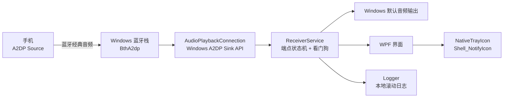

# BlueHarbor

[](https://github.com/Rylin512/blueharbor/releases)


**让 Windows 电脑成为一个稳定的蓝牙 A2DP 音频接收器。** 手机不需要安装 App，配对后把电脑当作蓝牙音箱即可。

BlueHarbor 用普通桌面进程持有 Windows 的 `AudioPlaybackConnection` 接收端，因此不会像 UWP 接收器那样被后台挂起。它用看门狗处理断线重连，用托盘图标保持后台可达，并提供日志与诊断，方便定位蓝牙链路问题。


## 目录

- [项目简介](#项目简介)
- [功能特性](#功能特性)
- [系统架构](#系统架构)
- [快速开始](#快速开始)
- [使用方式](#使用方式)
- [连接与音质](#连接与音质)
- [运行时行为](#运行时行为)
- [数据目录](#数据目录)
- [命令行与配置](#命令行与配置)
- [项目结构](#项目结构)
- [从源码构建](#从源码构建)
- [安装包](#安装包)
- [自检与日志](#自检与日志)
- [常见问题](#常见问题)
- [安全与隐私](#安全与隐私)
- [贡献](#贡献)
- [许可证](#许可证)

## 项目简介

Windows 没有把“我的电脑作为蓝牙音箱”做成一个显眼的系统功能。BlueHarbor 把官方 `AudioPlaybackConnection` API 包装成一个可长期驻留的托盘应用：

- **桌面常驻**：普通 Win32/WPF 进程，不依赖 UWP 生命周期，不会因为窗口关闭或应用空闲而被挂起；
- **稳定接收**：保持 A2DP Sink 端点注册，断线后自动恢复；
- **托盘可达**：关闭窗口只隐藏，接收端继续工作；托盘菜单可以暂停、恢复、开机启动和退出；
- **可诊断**：连接状态、重连、失败原因和启动耗时都写入本地日志。

它适合“手机在客厅/卧室播放，电脑接音箱”的场景，也适合把旧电脑或迷你主机改造成蓝牙音箱。

## 功能特性

| 能力 | 说明 |
|---|---|
| 原生 A2DP Sink | 使用 Windows 官方 `AudioPlaybackConnection`，不需要虚拟声卡或驱动 |
| 手机零安装 | 手机使用系统蓝牙即可，不需要 root、不需要装配合 App |
| 后台常驻 | 桌面进程持有接收端；关闭窗口只隐藏到托盘 |
| 看门狗重连 | 周期性检查端点状态，关闭后自动重开；设备不在线时等待链路恢复 |
| 退出清理 | 退出时先释放 A2DP 端点并等待蓝牙栈拆除，减少下次首连无声 |
| 首连自愈 | 上次异常退出或从旧版本升级时，首次连接会重新挂接一次端点 |
| 托盘图标 | 多尺寸图标 + 原生 `Shell_NotifyIcon` + WinForms 回退；Explorer 重启后自动恢复 |
| 自动修复无声 | 连接时检查默认输出是否静音/音量过低，自动取消静音并恢复可听音量 |
| 输出设备守护 | 记住用户选择的播放端点，启动时自动恢复，避免默认设备漂移到未使用的耳机/HDMI |
| 睡眠抑制 | 连接期间阻止系统空闲睡眠（可关闭） |
| 开机启动 | 登录后直接在托盘待命（可关闭） |
| 单实例 | 避免两个进程同时争抢同一个 A2DP 接收端 |
| 本地日志 | 滚动日志、最近事件、一键复制诊断信息 |
| 自包含发布 | 安装包和便携包都带 .NET 运行时，目标机不需要预装 .NET |

> 不重新编码音频，也不改变 Windows 协商出的编码。实际质量取决于 Windows 蓝牙栈、适配器和手机。

## 系统架构



设计原则：

- **不使用 UWP**：接收端对象必须活在一个不会被系统挂起的进程里。
- **端点只有一个**：同一时间只服务一个音频源，避免多个接收器抢占 A2DP。
- **状态可恢复**：蓝牙断开、设备休眠、Explorer 重启、系统唤醒都按可恢复路径处理。
- **应用不碰音质**：只负责接收端点，编码交给 Windows 与手机协商。

## 快速开始

### 环境要求

| 项目 | 要求 |
|---|---|
| 操作系统 | Windows 10 2004（build 19041）或更高版本 / Windows 11 |
| 架构 | x64 |
| 蓝牙 | 支持 A2DP Sink 的经典蓝牙适配器（绝大多数笔记本/台式机适配器） |
| 手机 | 已与电脑完成蓝牙配对；Android / iPhone 均可 |
| 权限 | 普通用户即可，不需要管理员权限 |

> 安装包与便携包都是自包含发布，目标机不需要安装 .NET 运行时。

### 方式一：安装包

从 [Releases](https://github.com/Rylin512/blueharbor/releases) 下载：

```text
BlueHarbor-Setup-1.0.7.exe
```

双击安装，默认安装到 `%LOCALAPPDATA%\Programs\BlueHarbor`。安装包未签名，SmartScreen 可能提示；选择“更多信息 → 仍要运行”。

如果安装器被安全软件拦截，不要继续和安装器纠缠，直接用方式二。

### 方式二：便携包

下载 `BlueHarbor-Portable-1.0.7.zip`，**完整解压到普通用户目录**（桌面、文档等，不要放在 `Program Files`），然后：

- 直接运行 `app\BlueHarbor.exe`；或
- 双击 `Install.cmd` 安装到当前用户目录。

不要把 zip 留在压缩包里直接运行，也不要在下载工具的临时预览里运行；这会让程序进入受限上下文，表现为没有托盘图标、注册表写入失败或安装器无法打开文件。

### 首次使用

1. 在 Windows“设置 → 蓝牙和其他设备”中配对手机。
2. 启动 BlueHarbor，选中手机卡片。
3. 点击“开启接收”。
4. 在手机上播放音乐，把蓝牙输出切到这台电脑。
5. 关闭主窗口会留在托盘继续工作；双击托盘图标可以回到界面。

如果任务栏右下角没有直接看到图标，点击 `^` 展开隐藏图标，找到 BlueHarbor 后拖到任务栏即可固定。

## 使用方式

主界面提供：

- 当前接收状态、已连接设备和连接时长；
- 已配对音频源列表，可切换接收设备；
- 自动重连、连接时保持系统唤醒、开机启动、关闭到托盘、状态通知；
- 音质路径说明、适配器信息、日志与诊断复制。

托盘菜单提供：

- 显示主界面；
- 开启/暂停接收；
- 开机启动；
- 连接时保持系统唤醒；
- 退出 BlueHarbor。

## 连接与音质

Windows 原生 A2DP 接收的编码由系统蓝牙栈决定：

| 编码 | Windows 原生 A2DP 接收 | 说明 |
|---|---|---|
| SBC | 支持 | 强制基线，所有设备都支持 |
| AAC | Windows 11 原生支持 | 实验选项；部分设备会出现“已连接但无声”，1.0.7 默认不启用 |
| aptX | 取决于适配器驱动 | 部分适配器在接收方向开放 |
| aptX HD / Adaptive | 否（原生） | 需要厂商驱动或专用硬件 |
| LDAC | 否（原生） | 应用层无法启用，需要驱动或专用硬件 |

BlueHarbor 不重新编码，也不会降低系统选定的质量。想确认当前编码，可以查看手机开发者选项中的“蓝牙音频编解码器”；Windows 端不提供统一的 A2DP Sink 编码查询 API。

### 稳定优先：默认 SBC

1.0.7 **默认使用 SBC**，不再自动启用 AAC。原因是部分手机/适配器在 A2DP Sink 方向协商 AAC 后会进入“显示已连接、端点 Opened，但完全没有声音”的状态；重连也不能恢复，必须回退 SBC。

主界面仍保留“启用 AAC（实验）”入口，便于确认设备兼容性：

- 开启需要管理员权限，写入机器级 `BthA2dp\BluetoothAacEnable=1`；
- 出现无声时点“回退 SBC”，会写回 `0` 并重新连接；
- Windows 没有逐连接选择编码的公开 API，最终编码仍由手机、适配器和 Windows 协商；
- 不能保证每台设备都能稳定使用 AAC。

### 输出设备

`AudioPlaybackConnection` 始终把手机音频送到 **Windows 当前默认播放设备**。如果默认设备是未插耳机的 USB 耳机、HDMI 显示器或虚拟声卡，手机端会显示已连接，但人听不到声音。

1.0.7 在“音质路径”卡片增加“输出设备”选择器：

- 列出当前活动的播放端点；
- 选中后立即设为 Windows 默认播放设备；
- 记住选择，下次启动自动恢复，避免 USB/蓝牙设备插拔后默认设备漂移；
- 切换后自动重新挂接 A2DP 端点，不需要手动暂停/开启。

如果仍然无声，先确认输出设备不是耳机/HDMI，再尝试“回退 SBC”。

提升稳定性的实用建议：

1. 在 Windows 蓝牙设备属性中取消“免提电话”服务，避免 HFP 抢占 A2DP；
2. 优先使用 SBC 兼容模式；AAC 只作为实验选项；
3. 关闭系统音效、空间音频等二次处理；
4. 如果必须使用 LDAC/aptX HD，需要换支持接收方向的适配器/驱动，或改用 Wi-Fi/USB 高音质链路。

## 运行时行为

### 连接状态机

```text
Off → Starting → Connecting → Connected
                         ↘ Waiting（手机不在线）
Connected → Reconnecting → Connected
```

- 看门狗约每 1.5 秒检查一次；
- 端点关闭后约 350ms 开始重试；
- 手机不在线时用蓝牙链路状态做门控，避免反复调用会阻塞数秒的 `OpenAsync`；
- 连续失败会指数退避，最大 30 秒；
- 设备被移除/蓝牙关闭后保留选择，设备恢复时自动回来。

### 退出与首连

- 正常退出：释放 `AudioPlaybackConnection`，等待约 700ms 让蓝牙栈拆除端点；
- 异常退出：在 `settings.json` 留下 `CleanShutdown=false`，下次启动首次连接会重新挂接端点；
- 正常退出：不额外重连，保持快速启动。

### 启动耗时

1.0.7 使用文件夹部署，启动时不再把 74MB 单文件解压到临时目录；日志会记录：

```text
启动完成，进程启动至今 1234 ms
```

启动耗时异常时，先检查是不是仍在运行旧的单文件版本。

## 数据目录

默认：

```text
%LOCALAPPDATA%\BlueHarbor\
├── settings.json       # 设备选择、开关、窗口位置、退出标记
└── logs\
    └── blueharbor-YYYYMMDD.log
```

便携/受限环境会按以下顺序回退：

1. `%LOCALAPPDATA%\BlueHarbor`
2. `BlueHarbor.exe` 同级 `BlueHarborData\`
3. `%TEMP%\BlueHarbor`

也可以用环境变量 `BLUEHARBOR_DATA_DIR` 显式指定。

日志按大小滚动，启动、连接、断开、重连、托盘注册和启动耗时会写入日志。日志不会上传。

## 命令行与配置

```text
BlueHarbor.exe                 正常启动并显示主窗口
BlueHarbor.exe --minimized     启动后直接在托盘待命
```

| 配置项 | 位置 | 说明 |
|---|---|---|
| 数据目录 | `BLUEHARBOR_DATA_DIR` | 覆盖设置和日志目录，适合便携/测试 |
| 设置 | `%LOCALAPPDATA%\BlueHarbor\settings.json` | 设备、开关、窗口位置、`CleanShutdown` |
| 日志 | `%LOCALAPPDATA%\BlueHarbor\logs` | 连接与启动诊断 |

## 项目结构

```text
BlueHarbor/
├── src/BlueHarbor/
│   ├── App.xaml / App.xaml.cs          启动、单实例、异常兜底
│   ├── MainWindow.xaml / .cs           主界面与窗口行为
│   ├── Services/
│   │   ├── ReceiverService.cs          A2DP 状态机与看门狗
│   │   ├── NativeTrayIcon.cs           Shell_NotifyIcon + GUID
│   │   ├── TrayIconService.cs          托盘菜单与 WinForms 回退
│   │   ├── AudioOutputService.cs       播放端点枚举与默认设备切换
│   │   ├── AacPreferenceService.cs     SBC/AAC 兼容开关
│   │   ├── Logger.cs                   滚动日志
│   │   ├── SettingsService.cs          JSON 设置
│   │   ├── StartupService.cs           HKCU 开机启动
│   │   ├── PowerService.cs             连接期间阻止睡眠
│   │   └── SingleInstance.cs           单实例
│   ├── ViewModels/                     界面状态与命令
│   ├── Themes/Styles.xaml              深色主题
│   └── Assets/                         应用与托盘图标
├── installer/BlueHarbor.nsi            NSIS 安装脚本
├── scripts/
│   ├── build.ps1                       构建/发布/安装包
│   └── fetch-winrt.ps1                 获取 WinRT 投影
├── tools/
│   ├── make-icon.ps1                   生成应用图标
│   └── make-tray-icon.ps1              生成多尺寸托盘图标
├──                  界面截图
├── LICENSE
└── README.md
```

## 从源码构建

### 依赖

- .NET 8 SDK
- Windows 10/11 SDK（提供 Windows.winmd / WinRT 投影）
- Node.js（仅 `fetch-winrt.ps1` 下载包时可选）
- NSIS 3.x（仅生成安装包时需要）

项目引用 `Microsoft.Windows.SDK.NET.Ref` 的投影程序集。首次构建前执行：

```powershell
powershell -ExecutionPolicy Bypass -File scripts/fetch-winrt.ps1
```

### 构建与运行

```powershell
dotnet build src/BlueHarbor/BlueHarbor.csproj -c Release
```

### 发布自包含文件夹

```powershell
dotnet publish src/BlueHarbor/BlueHarbor.csproj -c Release -r win-x64 `
  --self-contained true -o dist/app `
  -p:PublishSingleFile=false
```

### 一条命令打包

```powershell
powershell -ExecutionPolicy Bypass -File scripts/build.ps1
```

脚本会：

1. 检查/下载 WinRT 投影；
2. 发布自包含文件夹到 `dist/app`；
3. 复制 README、LICENSE、截图；
4. 如果找到 `makensis`，生成 `dist/BlueHarbor-Setup-1.0.7.exe`。

### 生成安装包

```powershell
makensis installer/BlueHarbor.nsi
```

## 安装包

发布资产：

- `BlueHarbor-Setup-1.0.7.exe`：NSIS 安装包，按用户安装；
- `BlueHarbor-Portable-1.0.7.zip`：解压即用，内含 `Install.cmd`；
- `SHA256SUMS.txt`：校验值。

安装包未做代码签名。SmartScreen 拦截并不代表程序有问题；如果没有代码签名证书，无法从应用层消除该提示。安装器打不开时优先使用 ZIP 里的 `Install.cmd`。

## 自检与日志

遇到问题时先看：

```text
%LOCALAPPDATA%\BlueHarbor\logs\blueharbor-YYYYMMDD.log
```

重点行：

```text
数据目录：
Session：
系统托盘图标已创建
Shell_NotifyIcon ...
打开接收端点：Success
首次连接将执行一次端点自愈
接收端点已释放
```

“复制诊断”会把版本、系统、适配器、当前状态、设备列表和最近日志复制到剪贴板。

## 常见问题

### 任务栏没有 BlueHarbor 图标

1. 点击任务栏的 `^`，查看隐藏图标里是否有 BlueHarbor；有就拖到任务栏固定。
2. 如果日志出现 `Shell_NotifyIcon ... 失败`，通常是程序在受限桌面/沙盒中运行；请从 Windows 资源管理器直接启动 exe，而不是从压缩包预览或下载工具临时目录启动。
3. 1.0.7 会在 Explorer 重启后自动重建图标，并尝试修复 `NotifyIconSettings` 中指向旧 exe 的条目。

### 连接成功但完全没有声音

按以下顺序排查：

1. **输出设备**：主界面“输出设备”选择器里是否选中了实际在用的扬声器。默认设备如果是没插耳机的 USB 耳机、HDMI 或虚拟声卡，手机显示已连接也不会有声音。
2. **系统静音/音量**：1.0.7 在连接时和启动时会自动取消默认输出的静音，并在音量低于 15% 时提升到 35%；但如果你手动把音量调得很低，仍可能听不到。
3. **AAC 实验模式**：如果曾开启 AAC，点“回退 SBC”。部分设备协商 AAC 后会“Opened 但无声”，重连无效。
4. **端点路由**：正常退出会等待端点释放；异常退出后的首次连接会自动重新挂接。仍无声时，把日志发到 Issues，附手机型号、Windows 版本、输出设备名和是否使用过 AAC。

### 安装器提示“无法打开文件”

通常是 Windows 安全策略/杀毒软件拦截未签名安装器，或旧 BlueHarbor 进程仍占用文件。先退出托盘中的旧程序，再改用 ZIP 里的 `Install.cmd`。

### 支持 LDAC / aptX HD 吗？

不支持在应用层启用。Windows 没有原生 A2DP Sink LDAC 实现；请参考上面的编码表。

### 手机长时间没声音会断开吗？

应用侧会保持端点并自动重连。手机厂商的省电策略可能在长时间静音后主动断开 A2DP；这不属于应用能控制的范围，但 BlueHarbor 会在手机恢复连接时尽快重开。

### 可以同时连接两台手机吗？

不建议。BlueHarbor 同一时间只服务一个接收设备；切换设备请在主界面选择另一台手机。

## 安全与隐私

- 不联网、不上传遥测；
- 只读取 Windows 已配对的蓝牙音频源；
- 设置与日志仅保存在本机；
- 不修改手机、不安装驱动、不要求管理员权限；
- 安装包和 exe 未签名，请从本仓库 Releases 下载并核对 `SHA256SUMS.txt`。

## 贡献

欢迎提交 Issue 和 PR。请尽量附带：

- Windows 版本与 build；
- 手机型号/系统；
- 蓝牙适配器型号；
- 日志中从启动到问题发生的时间段；
- 是否能稳定复现。

## 许可证

[MIT](LICENSE)
